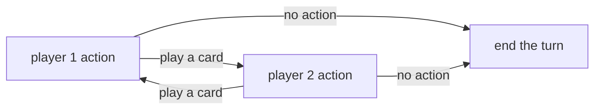

## Card game

### Concept

 

The game focuses on you being a sorcerer, which is against another sorcerer. You two battles through the usage of spells, while evocations and places can provide benificial effects.

 

##### Design principles

 

* As form for scaling, the game is based on action limit, similar to "yu gi oh” or “vanguard”. The game, though, should not rely on **special actions**, that may introduce polarizing loopholes in the game
  * actions are limited by the color of cards already onto the field. The idea of this is to limit the queen problem, by imposing multiple turn accumulation to play cards from different colors
  * actions are reactive [explored after](#mana-design)
* cards that can win the game through combat cannot be permanent, must be spells. This idea is used to avoid dominance of permanent cards over spells
* permanent cards should be contained outside the game. in this way, problems such as mana flood and mana screw are avoided. each turn, a single permenent card can be played.
* each deck as max 3 copies of the same card in the main deck, for a deck of up to 20 cards, while permanents can have max  copy and a deck of up to 5 cards.
* main life resource is the spell deck. When the deck ends, the player loses
  * combat damage is inflicted by milling cards from the top of the deck
  * only the turn player inflict damage, opponent player can only block the turn player attack
* stack of spells played is not related to the zone, rather, it is global.

##### Field

 

| opponent 1 | opponent 2 | opponent 3 |               |                  |
| :--------- | :--------- | :--------- | :------------ | :--------------- |
| Zone 1     | Zone 2     | Zone 3     | Graveyard     |                  |
|            |            |            | Deck - spells | Deck - permanent |

 

##### Type of cards

 

Cards can be of two main types:

 

* spell: cards used to attack the opponent. They have an attack value and a color. They can be played only if a permanent with the same color is onto the player field. they can have two trigger for their effect
  * [act]: activate effect, effects are resolved immediately when the card is activated 
  * \[res]: resolution effects, effects are resolved when the card goes to the graveyard
* Permanent: Cards that are placed onto a zone the player controls. This cards have a defense point and an effect. Effects can only be continuous, thus, applied continuously until the card stays into a zone. Each player can only play one of those cards per turn.

##### Mana design

 

The game uses a 3 color based mana system. In this system, the player is not required to have “X mana to play a card”, rather, you must have at least one permanent card of the specific color.  In this way, the player can technically play any card in her deck, but to play it her should have the correct permanent to play it.

 

The game should be action based, thus, the limitation of cards to play in a turn is given by the number of actions granted each turn. In particular, this game uses limitations based on the opponent’s responses.

 

 

##### Combat design

Turns can be described by the following flowchart:

* turn player: draw
* turn player: play permanent from top of the deck or activate spell from hand
* opponent player: respond to turn player?

  * Yes: start action diagram
  * No: end of the turn
* on end of the turn:

  * &#x20;spells played are sent to the graveyard, from the most recent to the least recent (apply res effects)
  * Damage is calculated as follows$\sum{Damage_{turn\ player}} - (\sum{Damage_{opponent\ player}} + \sum{Defense_{opponent\ player}})$where damage is the power of spell, while defense is the defense of permanents

The opponent player can respond either with spells (equal to the attacking spells) and permanents onto their field. Permanenent used as defense are destroyed. cards used in this way are added to the stack.

 

Permanents destroyed in any way come back into the deck, while spells are sent to the graveyard. 

 

##### Effect examples

 

###### keywords

* Chain: if your opponent doesn’t respond to this card, you can continue the chian by playing another card
* Priority: you can play a card immediately before your opponent responds

###### conditions

* reveal X cards from the top of the deck
* one of your cards loses its effects
* discard X cards

###### Interruptions

* Card X gain +X power
* Card X loses -X power
* Destroy target land
* Opponent must answer by playing a permanent (for attack)
* Opponent must answer by playing  a spell
* target player mill X cards

###### Resource

* Draw X cards
* Activate a land from top of the deck
* play a card from the graveyard
* add card from graveyard to the hand
* shuffle X cards from target graveyard into the deck
