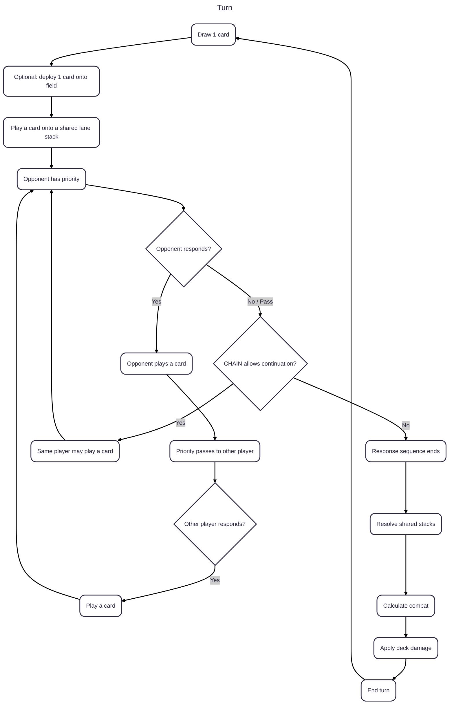
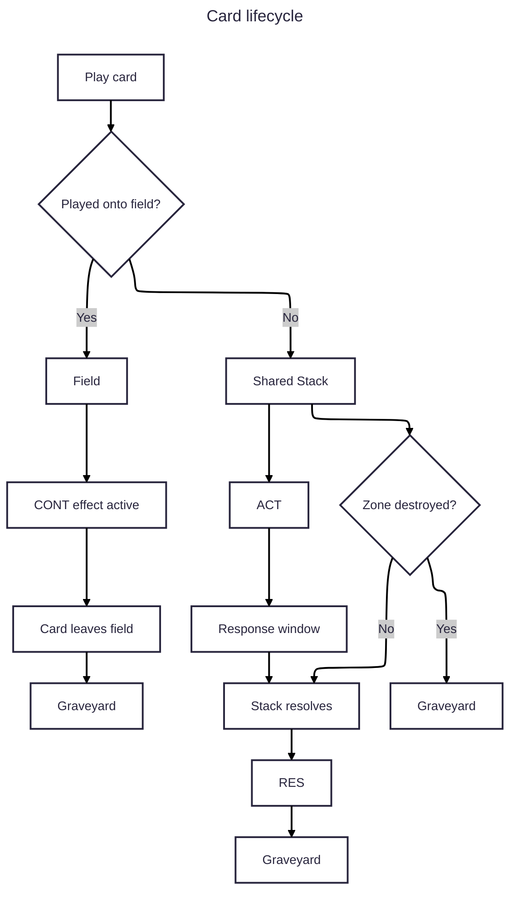

# Card Game

## Setting

The game takes place in a dark and occult fantasy world where powerful **sorcerers** compete by manipulating forbidden magic from their personal grimoires.

Each player assumes the role of a sorcerer.

A sorcerer's deck represents their **Grimoire**: a collection of spells, creatures, places, curses, blessings, rituals, and other supernatural phenomena that the sorcerer has learned or bound to their will.

The sorcerers do not fight directly.

Instead, they open manifestations of their magic across three fronts, using their grimoire to create increasingly dangerous situations. A manifestation might begin as a simple patch of corrupted earth and eventually become a battlefield filled with demons, eldritch creatures, cursed objects, divine intervention, and catastrophic phenomena.

The opposing sorcerer attempts to survive these manifestations while using their own grimoire to interfere with them.

The ultimate goal is to **exhaust the opponent's Grimoire**.

When a sorcerer can no longer sustain their magic, they lose.

---

# The Grimoire

Each player's 40-card deck is their **Grimoire**.

The Grimoire is not simply a collection of cards. It represents the knowledge and supernatural forces available to the sorcerer.

Cards leaving the Grimoire represent fragments of that knowledge being consumed.

Therefore, taking damage does not represent conventional physical injury.

Instead, damage represents the opponent forcing the sorcerer to **burn through their Grimoire**.

A card milled from the deck is knowledge that has been lost, destroyed, forgotten, or otherwise made inaccessible.

When the Grimoire is exhausted, the sorcerer can no longer sustain their magic and loses the game.

---

# The Three Manifestations

The sorcerer's field consists of three manifestations.

Each manifestation is a place where the sorcerer's magic takes physical form.

A manifestation might represent:

* a cursed forest;
* a burning volcano;
* a flooded crypt;
* a forgotten temple;
* a battlefield;
* an opening into another dimension;
* an ancient burial ground;
* a place between life and death.

The three manifestations are fixed positions on the table.

They are not necessarily literal locations in the world.

They represent three simultaneous fronts at which the sorcerers are manipulating reality.

Each manifestation has a field card belonging to each sorcerer and a shared stack.

---

# The Arcane Stack

The stack represents the magical events currently unfolding within a manifestation.

Unlike the field, the stack does not belong to either sorcerer.

Both sorcerers are attempting to manipulate the same supernatural event.

One sorcerer may summon a creature.

The other may introduce a curse.

The first may then add another spell.

The second may answer by introducing something even more dangerous.

The result is an escalating chain of magical events.

This is why the stack is shared:

> **The sorcerers are not casting spells at each other. They are fighting over what reality becomes.**

---

# Attributes

The five fundamental attributes represent the major forces through which sorcery manifests.

| Attribute | Color | Theme                                                  |
| --------- | ----- | ------------------------------------------------------ |
| **Earth** | Green | Nature, beasts, flesh, growth, decay                   |
| **Water** | Blue  | Oceans, storms, drowning, transformation, knowledge    |
| **Fire**  | Red   | Destruction, volcanoes, blood, rage, catastrophe       |
| **Light** | White | Divinity, angels, blessings, purity, judgment          |
| **Dark**  | Black | Death, curses, possession, demons, forbidden knowledge |

These are not necessarily moral alignments.

Light can be terrifying.

Earth can be grotesque.

Water can represent cosmic depths.

Fire can be both creation and destruction.

Dark represents the forbidden and the dead, but its creatures and effects need not simply be "evil."

The attribute of a manifestation determines which forces that sorcerer can channel into it.

---

# Card Philosophy

Cards should represent **strange supernatural events**, rather than conventional fantasy units whenever possible.

The game should feel like reading fragments of an occult grimoire and discovering increasingly disturbing illustrations and descriptions.

Cards should therefore favor concepts such as:

* impossible creatures;
* unnatural transformations;
* occult rituals;
* cursed objects;
* supernatural locations;
* divine apparitions;
* eldritch phenomena;
* grotesque interactions;
* catastrophes;
* ancient entities;
* obscure magical knowledge.

The world should feel unpredictable and occasionally absurd, but never cheerful.

---
# Tone

The game should have a **dark fantasy / occult horror** atmosphere.

However, it should not be restricted to medieval European fantasy.

The Grimoire can contain:

* medieval occultism;
* cosmic horror;
* biological horror;
* folklore;
* religious imagery;
* surrealism;
* enormous animals;
* cursed artifacts;
* impossible machines;
* ancient gods;
* bizarre magical phenomena.

The common element is that every card should feel like something a sorcerer might discover while reading a forbidden book.

---

# Visual Language

The cards should look like pages or illustrations extracted from an ancient magical manuscript.

Possible visual elements include:

* aged paper;
* handwritten annotations;
* occult diagrams;
* anatomical drawings;
* strange symbols;
* astronomical charts;
* medieval marginalia;
* faded paintings;
* ink illustrations;
* handwritten spell names;
* diagrams showing impossible creatures.

The card frame should distinguish the mechanical information from the illustration while retaining the feeling of an artifact from the Grimoire.

The illustration should often tell a story independently of the rules text.

For example:

> **Over Leeching**

The card does not need to explain:

> "A gigantic lamprey is sucking the blood of a whale."

The artwork should already communicate that.

The rules then explain what that creature does mechanically.

---

# The Sorcerer

The player is not represented by a creature on the battlefield.

The player **is the sorcerer**.

The cards are manifestations of their knowledge and will.

This distinction is important.

The sorcerer does not summon a creature and then personally fight alongside it.

Instead, the sorcerer manipulates reality through the Grimoire.

This allows the game to have cards representing things of radically different scales:

```text id="e5f1fp"
A possessed man
      ↓
A gigantic whale
      ↓
A floating Man-o-War
      ↓
A volcano
      ↓
A maelstrom
      ↓
An entity beyond the veil
```

All of these can exist naturally within the same game because they are manifestations of the sorcerer's magic.

---

# The Grimoire as the Life Total

The game has deliberately no traditional Life Points.

The Grimoire itself is the resource that determines survival.

When a sorcerer suffers damage:

> **Their Grimoire is consumed.**

Cards disappear from the deck.

This makes the victory condition thematically meaningful:

> The winner is not necessarily the sorcerer who killed the opponent.

> The winner is the sorcerer who **outlasted the other's knowledge**.

This also allows cards that interact with the graveyard and discarded knowledge to have a strong thematic role.

A card such as **Dredge for Deads** can literally represent recovering things that were thought to have been lost.

A card such as **The First Grimoire** can represent accessing knowledge that predates the current sorcerer's understanding.

A card such as **Over the Veil** can represent discovering knowledge that perhaps should never have been discovered.


---

# Objective

Each player starts with a deck of 40 cards.

Whenever a player takes damage, they mill cards from the top of their deck equal to the amount of damage taken.

A player loses when they are required to draw or mill a card while their deck contains no cards.

The game ends when only one player remains with cards in their deck.

If both players lose simultaneously, the game is a draw.

---

# Table

The table contains three field zones for each player.

Each pair of opposing zones forms a **lane**.

Each lane has exactly one shared stack.

```text
                    OPPONENT

              ┌───────┬───────┬───────┐
              │ Zone 1│ Zone 2│ Zone 3│
              │  B    │  B    │  B    │
              └───────┴───────┴───────┘
                 │       │       │
               Stack   Stack   Stack
                 │       │       │
              ┌───────┬───────┬───────┐
              │ Zone 1│ Zone 2│ Zone 3│
              │  A    │  A    │  A    │
              └───────┴───────┴───────┘

                     PLAYER
```

For each lane:

* Player A has one field zone.
* Player B has one opposing field zone.
* Both players share the same stack.
* Either player may add cards to that stack if they satisfy the requirements for their own field zone.

The stack is therefore **not owned by either player**.

---

# Hand

Each player has a private hand.

The contents of a player's hand are hidden from the opponent unless an effect reveals them.

A player may have any number of cards in their hand.

---

# Field

Each player controls three fixed field zones.

A field zone can contain at most one field card.

A field card remains in its zone until it is destroyed, removed, or moved by an effect.

Cards on the field cannot normally be moved between zones.

Each field zone participates in one shared stack.

The field card belonging to a player determines which attributes that player may use when playing cards into the corresponding shared stack.

### Example

Suppose lane 1 contains:

```text
Player B
┌─────────────┐
│ Blue Dragon │
└─────────────┘
      │
   Stack 1
      │
┌─────────────┐
│ Red Temple  │
└─────────────┘
Player A
```

Player A may play cards with the attributes allowed by **Red Temple**.

Player B may play cards with the attributes allowed by **Blue Dragon**.

The two players therefore use the same stack, but have different restrictions for adding cards to it.

---

# Stack

Each lane has exactly one stack shared by both players.

A stack contains cards that have been played into that lane but have not yet resolved.

Cards are ordered by the time they were played.

The newest card is placed on top.

The stack therefore resolves in **last-in, first-out (LIFO)** order.

```text
             TOP
              │
              ▼
        ┌─────────────┐
        │ Player B    │  newest
        │ Water Spell │
        ├─────────────┤
        │ Player A    │
        │ Fire Beast  │
        ├─────────────┤
        │ Player B    │
        │ Blue Spirit │
        └─────────────┘
              ▲
             BOTTOM
```

Cards belonging to both players can exist in the same stack.

The stack does not belong to either player.

---

## Stack ownership

Although the stack itself is shared, every card on the stack retains its owner.

The owner is the player who played the card.

This ownership matters for:

* attribute restrictions;
* effects that refer to a player's cards;
* attack;
* defense;
* card-specific effects;
* card destinations.

---

## Stack defense

The cards currently present in a stack contribute **Stack Defense**.

Stack Defense is calculated independently for each lane.

Unless an effect specifies otherwise:

```text
Stack Defense =
    sum of the Defense values
    of all cards currently in the lane's stack
```

Stack Defense is shared by the lane.

It does not belong exclusively to the player who controls more cards in the stack.

For example:

```text
Stack 1

Player A — Creature — Defense 3
Player B — Spell    — Defense 2
Player A — Creature — Defense 4

Stack Defense = 3 + 2 + 4 = 9
```

The entire stack therefore contributes **9 Stack Defense** to combat in that lane.

---

# Graveyard

The graveyard contains cards that leave the field or finish resolving from a stack, unless another effect specifies another destination.

Cards in the graveyard are normally face-up and known to both players.

The order of cards in the graveyard is normally irrelevant.

---

# Cards

Each card has several characteristics.

## Name

The name identifies the card.

The deck-building limit is based on card name.

---

## Attributes

Cards can have one or more attributes.

The basic attributes are:

| Attribute | Color | Theme                          |
| --------- | ----- | ------------------------------ |
| Earth     | Green | Nature, stability, growth      |
| Water     | Blue  | Flow, adaptation, knowledge    |
| Fire      | Red   | Destruction, aggression, power |
| Light     | White | Order, protection, purity      |
| Dark      | Black | Decay, sacrifice, corruption   |

Attributes determine which cards a player can play into a shared stack.

### Attribute requirement

When a player wants to play a card into a lane's stack, that card must share an attribute with the **field card controlled by that player in that lane**.

The requirement is checked using the player who is playing the card.

It does not matter which cards are already present in the shared stack.

### Example

Player A controls a Red field card.

Player B controls a Blue field card.

The shared stack can therefore contain:

```text
Player A → Red card
Player B → Blue card
Player A → Red card
Player B → Blue card
```

A cannot use B's Blue field card to satisfy the requirement for a Blue card.

Likewise, B cannot use A's Red field card.

The restriction is always based on **ownership of the field card**, not ownership of the stack.

### Empty field zone

If a player has no field card in a lane, that player cannot normally play cards into that lane's stack.

Effects may explicitly allow cards to be played despite this restriction.

---

# Effects

Effects are the primary mechanism for interaction.

An effect changes the game state when its activation condition is satisfied.

Effects are divided into several categories.

---

## `CHAIN`

A `CHAIN` effect allows the player to continue playing cards after the opponent passes.

Normally, a player cannot play two consecutive cards during the same response sequence.

For example:

```text
Player A plays A1
        ↓
Player B passes
        ↓
Player A cannot play another card
```

If A1 has `CHAIN`, however:

```text
Player A plays A1
        ↓
Player B passes
        ↓
A1 grants CHAIN
        ↓
Player A may play A2
```

The `CHAIN` permission belongs to the current response sequence.

It allows its controller to continue the chain after the opponent passes.

### CHAIN does not skip the opponent

After A uses `CHAIN` to play A2, priority passes to B again.

Therefore:

```text
A1 [CHAIN]
 ↓
B passes
 ↓
A2
 ↓
B may respond
```

`CHAIN` allows a player to continue after a pass; it does not give unlimited consecutive plays.

---

## `PRIORITY`

A `PRIORITY` effect allows its card to be played immediately when its triggering condition is satisfied.

The opponent does not receive priority before the card is played.

After the card has been played, normal priority rules apply.

`PRIORITY` therefore changes **when a card enters the stack**, but does not negate another card.

---

## `CONT`

A `CONT` effect is a continuous effect.

It remains active while the card producing it is on the field.

When that card leaves the field, its `CONT` effect stops applying unless the effect explicitly states otherwise.

---

## `ACT`

An `ACT` effect activates when its card is played onto a stack.

The effect becomes part of the card's resolution.

It does not resolve independently before the card reaches the appropriate position in the stack.

---

## `RES`

A `RES` effect activates when its card resolves and leaves the stack.

The `RES` effect happens immediately before the card is sent to the graveyard, unless another destination is specified.

A card that is removed from a stack because its field zone is destroyed does **not** activate its `RES` effect.

---

# Attack and Defense

Cards may have Attack and Defense values.

### Attack

Attack determines how much damage a player's cards can inflict during combat.

### Defense

Defense contributes to the defensive value of a card.

When a card is on a field, its Defense contributes to the defense of that field zone.

When a card is on a stack, its Defense contributes to the lane's **Stack Defense**.

Therefore, a lane can have three separate defensive components:

```text
Player A Field Defense
Player B Field Defense
Shared Stack Defense
```

---

# Card Types

There are three basic card types.

## Land

Land cards:

* have no Attack;
* have Defense;
* can only be played onto the field;
* cannot normally be played onto a stack.

A Land provides a permanent field presence and contributes its Defense to its zone.

---

## Creature

Creature cards have both Attack and Defense.

Creatures can be played:

* directly onto the field; or
* onto a stack.

A Creature played onto the field becomes the permanent card occupying that player's zone.

A Creature played onto a stack participates in the current action.

When a Creature is played from the field onto a stack, it leaves the field immediately.

It does not return to the field after resolving unless an effect explicitly returns it.

---

## Spell

Spell cards have Attack and Defense.

Spells can only be played onto a stack.

They cannot normally occupy a field zone.

After resolving, a Spell is normally sent to the graveyard.

---

# Deck Construction

Each deck contains exactly **40 cards**.

A player may include a maximum of **3 copies of a card with the same name**.

There is no minimum or maximum hand size.

---

# Gameplay

Each player begins the game with 4 cards in hand.

Players then alternate turns.

At the beginning of their turn, the turn player draws one card.

A turn consists of:

1. Draw
2. Deployment
3. Action
4. Resolution
5. Damage
6. End Turn

---

# 1. Draw

The turn player draws one card from the top of their deck.

If their deck is empty when they are required to draw, they lose the game.

---

# 2. Deployment

The turn player may play one card from their hand directly onto one of their field zones.

This is optional.

Playing a card directly onto the field does not use a shared stack.

It therefore does not create a response opportunity.

A player cannot deploy a card into a field zone that they already occupy unless an effect explicitly allows it.

---

# 3. Action

The turn player may initiate an action by playing a card into one of the three shared stacks.

The card must satisfy all requirements for being played.

In particular, the card must satisfy the attribute requirement determined by the turn player's own field card in that lane.

Playing the first card begins a **response sequence**.

---

# Response System

The response system is the main source of interaction in the game.

The fundamental rule is:

> **A player may only play a card when they have priority.**

When a player plays a card, priority normally passes to the opponent.

The opponent has two choices:

* **Respond:** play a card into the appropriate stack.
* **Pass:** decline to respond.

After the opponent responds, priority returns to the other player.

After the opponent passes, the player who originally played the card does **not** automatically regain the ability to play another card.

This is intentional.

---

## Basic response sequence

Suppose Player A starts a chain.

```text
A plays A1
    ↓
B receives priority
    ↓
B plays B1
    ↓
A receives priority
    ↓
A plays A2
    ↓
B receives priority
```

The players alternate normally.

---

## Passing

Passing means:

> "I do not want to add a card to this response sequence at this moment."

If a player passes, priority goes to the other player.

A player cannot immediately play another card after their opponent passes.

### Example

```text
A plays A1
      ↓
B passes
      ↓
A cannot play A2
```

The response sequence therefore ends if the relevant player has no legal `CHAIN` permission and both players have declined to continue.

---

# CHAIN and Passing

`CHAIN` exists specifically to break the normal restriction created by passing.

Suppose A plays a card with `CHAIN`.

```text
A plays A1 [CHAIN]
      ↓
B passes
      ↓
A may play A2
```

Without `CHAIN`:

```text
A plays A1
      ↓
B passes
      ↓
A cannot play A2
      ↓
resolve
```

With `CHAIN`:

```text
A plays A1 [CHAIN]
      ↓
B passes
      ↓
A plays A2
      ↓
B receives priority
```

Therefore, `CHAIN` is not simply an additional effect.

It is a **permission to maintain initiative**.

---

# Ending a Response Sequence

A response sequence ends when the active opportunity to respond has been exhausted.

In the normal case:

```text
A plays A1
    ↓
B passes
    ↓
A cannot continue
    ↓
Resolve
```

If A1 has `CHAIN`:

```text
A plays A1 [CHAIN]
    ↓
B passes
    ↓
A plays A2
    ↓
B passes
    ↓
A cannot continue unless A2 also grants CHAIN
    ↓
Resolve
```

If both players continue responding, the sequence may become arbitrarily long.

This is intentional and is one of the primary sources of interaction.

---

# No Negation

There are no generic effects whose purpose is to cancel another card.

A player cannot normally:

* negate a card;
* counter a card;
* cancel an effect;
* remove a card from the stack before it resolves;
* make an already-played card "not have been played."

Interaction happens by **adding new cards and effects**.

For example:

```text
A plays Fire Beast.

B does not negate Fire Beast.

Instead B plays Water Barrier.

A responds with Burning Ritual.

B responds with Tide Spirit.
```

All four cards exist in the game and remain part of the stack until they resolve or are removed by an explicitly defined game effect.

---

# Stack Resolution

When the response sequence ends, the shared stacks resolve.

Each stack resolves independently in LIFO order.

The top card of a stack resolves first.

```text
TOP
 ↓
B3  ← resolves first
A2
B1
A1  ← resolves last
```

A card resolving may generate additional effects.

Those effects are resolved according to their rules before continuing with the next card.

---

# Multiple Stacks

Because there are three lanes, all three lanes may contain pending cards at the same time.

When the response sequence ends, the three stacks are resolved.

Each lane retains its own order.

For example:

```text
Lane 1: A1 → B1 → A2
Lane 2: B2 → A3
Lane 3: A4
```

Each lane resolves according to its own stack order.

Effects that interact with another lane may affect that lane before its cards resolve.

---

# Stack Destruction

If a field zone is destroyed while its shared stack contains cards, every card currently in that stack is sent to the graveyard.

This applies to cards belonging to **both players**.

Those cards:

* do not resolve;
* do not activate their `RES` effects;
* do not contribute Attack during the current combat;
* do not contribute Stack Defense after being removed.

Destroying a field therefore destroys the pending activity of the entire lane.

This is not considered a negation.

The cards were successfully played; the board state simply caused the stack to be destroyed before resolution.

---

# Combat

After all relevant stacks have resolved, combat is calculated separately for each lane.

Combat uses three values:

1. **Attacker Attack**
2. **Defender Field Defense**
3. **Shared Stack Defense**

The basic formula is:

```text
Damage = max(
    0,
    Attack - Field Defense - Stack Defense
)
```

The important distinction is that **Stack Defense is additional defense**.

It is not part of the field card's Defense.

---

## Attack

Each player's attacking cards in a lane contribute their Attack.

Unless an effect specifies otherwise:

```text
Player Attack =
    sum of Attack values
    of that player's cards played into the lane
```

The two players therefore calculate their attacks separately.

---

## Field Defense

The defending player's field card contributes its Defense.

If the defending player has no field card in that lane:

```text
Field Defense = 0
```

---

## Stack Defense

All cards currently contributing to the lane's stack contribute their Defense to the shared Stack Defense value.

For example:

```text
Shared stack:

Player A Creature
Attack: 4
Defense: 2

Player B Spell
Attack: 2
Defense: 3

Player A Spell
Attack: 3
Defense: 1

Stack Defense = 2 + 3 + 1
              = 6
```

The stack therefore contributes 6 additional Defense to combat.

---

# Combat Example

Suppose lane 1 contains:

### Player A

```text
Field:
Fire Beast
Defense: 5

Stack cards:
Fire Spirit
Attack: 6
Defense: 2

Flame Spell
Attack: 3
Defense: 1
```

### Player B

```text
Field:
Water Guardian
Defense: 4

Stack cards:
Water Shield
Attack: 2
Defense: 3
```

The shared Stack Defense is:

```text
2 + 1 + 3 = 6
```

Player A's attack is:

```text
6 + 3 = 9
```

Player B's attack is:

```text
2
```

If Player A attacks Player B's zone:

```text
9 - 4 - 6 = -1
```

Therefore:

```text
Damage = 0
```

Player B's Water Guardian survives.

If Player B attacks Player A's zone:

```text
2 - 5 - 6 = -9
```

Therefore:

```text
Damage = 0
```

Player A's Fire Beast survives.

The shared stack can therefore function as a temporary defensive layer for the lane.

---

# Direct Damage

If a player has no field card in the opposing zone, attacks can reach the player directly.

In that case:

```text
Field Defense = 0
```

The Stack Defense still applies.

Therefore:

```text
Damage = max(0, Attack - Stack Defense)
```

The resulting damage is milled from the opponent's deck.

### Example

Player A attacks an empty zone with 10 Attack.

The shared stack has 3 Defense.

```text
10 - 0 - 3 = 7
```

Player B therefore takes 7 damage and mills 7 cards.

---

# Zone Destruction

If the attack against an occupied zone produces enough damage to destroy the field card, the field card is destroyed.

A field card is destroyed when:

```text
Damage > Field Defense
```

The field card is sent to the graveyard.

The zone then becomes empty.

The stack is also destroyed as described in [Stack Destruction](#stack-destruction).

### Important distinction

The Stack Defense is used to calculate the damage.

It does **not** become damage counters on the stack.

After combat, the temporary Stack Defense disappears when the stack cards leave the stack.

---

# Deck Damage

Whenever a player takes damage, they mill cards from the top of their deck equal to the damage.

For example:

```text
Damage = 5

Top of deck
    ↓
Card 1 → Graveyard
Card 2 → Graveyard
Card 3 → Graveyard
Card 4 → Graveyard
Card 5 → Graveyard
```

If the player has fewer cards remaining than the amount of damage, all remaining cards are milled and the player loses.

---

# Card Lifecycle

## Field card

```text
Hand
  ↓
Field
  ↓
CONT effect active
  ↓
Destroyed / removed
  ↓
Graveyard
```

---

## Stack card

```text
Hand / Field
      ↓
Shared Stack
      ↓
ACT
      ↓
Other players may respond
      ↓
Stack resolves
      ↓
RES
      ↓
Graveyard
```

---

## Destroyed stack

```text
Hand / Field
      ↓
Shared Stack
      ↓
Field zone destroyed
      ↓
Graveyard
```

A card removed this way does not activate `RES`.

---

# Complete Turn Structure



---

# Card Lifecycle



---

# Design Principles

## 1. The stack is shared

There are only three stacks.

Each stack represents the activity happening in one lane.

Both players contribute cards to it.

This makes a lane a contested tactical space rather than two independent piles of cards.

---

## 2. Attribute identity belongs to the player

The stack is shared, but the attribute requirement is not.

Each player looks only at their own field card.

This allows a single lane to contain cards from completely different attribute identities.

For example:

```text
A: Fire field
B: Water field

Shared Stack:
    A Fire Creature
    B Water Spell
    A Fire Spell
    B Water Creature
```

This creates an interesting asymmetry without requiring separate stacks.

---

## 3. Passing gives up initiative

A player cannot endlessly chain cards simply because they were the player who started the action.

Normally:

```text
A → B → A → B → ...
```

A player only gets to continue after the opponent passes if `CHAIN` explicitly permits it.

This makes `CHAIN` a strategically important keyword.

---

## 4. Defense has two layers

A lane's defense is composed of:

```text
Field Defense + Stack Defense
```

The field provides persistent protection.

The stack provides temporary protection.

Therefore, committing defensive cards to a stack can protect a lane during the current action, but those cards are temporary and disappear when the stack resolves.

---

## 5. Interaction is additive

There are no generic negations.

Players interact by adding cards to the shared stack.

A player therefore does not ask:

> "Can I stop your card?"

Instead, they ask:

> "What can I add to this lane to change what happens?"

This should make the game feel much more like a tactical escalation than a counterspell duel.

---

## 6. Commitment creates risk

Because the stack is shared and its Defense contributes to combat, adding cards has two opposing effects:

* it increases the amount of Attack available;
* it increases the amount of Stack Defense protecting the lane.

At the same time, destroying the field card can destroy the entire shared stack.

Players therefore have to decide how much they want to commit to each lane.
